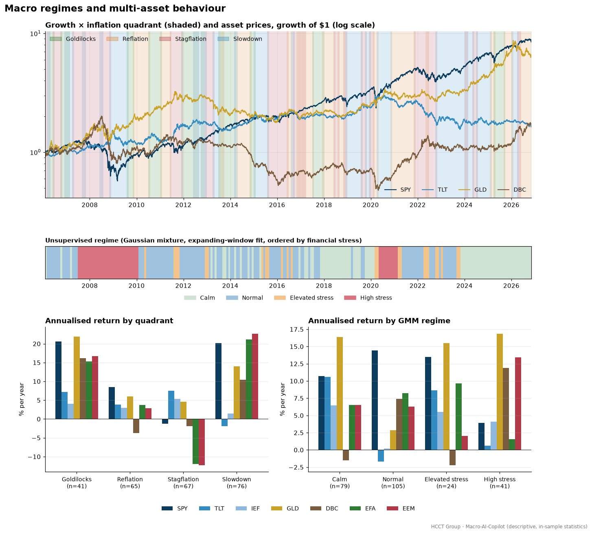
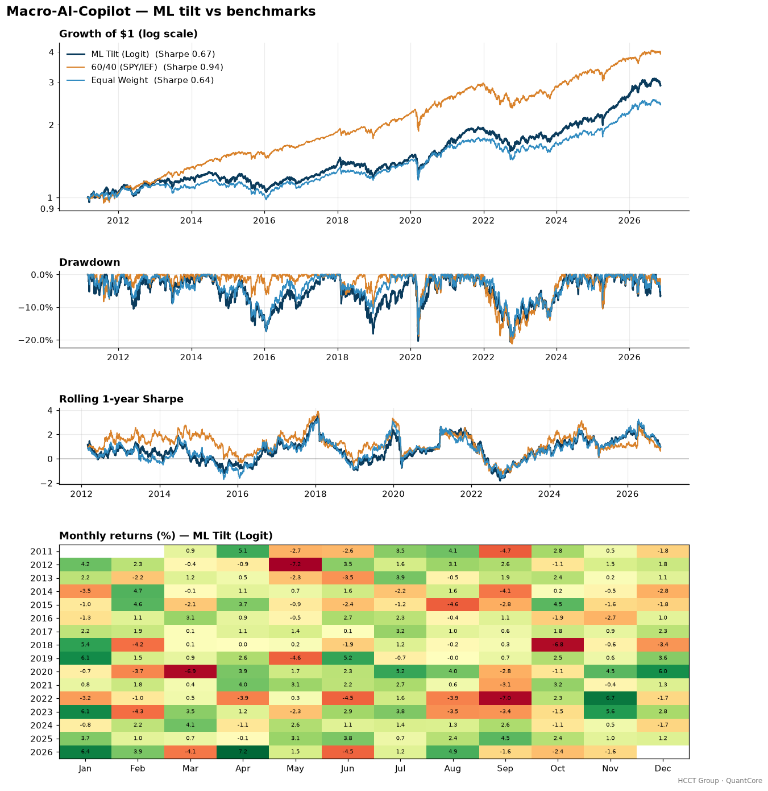

# HCCT Group – Macro-AI-Copilot

**End-to-end macro, machine learning, and multi-asset allocation system in Python.**
Created by **Harry CHU** · HCCT Group

[](https://github.com/hcctbusiness/Macro-AI-Copilot/actions/workflows/ci.yml)


Macro-AI-Copilot is a "macro radar". It turns public US macro data into a point-in-time macro state, labels the economic regime, uses walk-forward machine learning to predict which of seven ETFs will outperform next month, and turns those predictions into a long-only portfolio. The portfolio is backtested with costs against 60/40 and equal-weight benchmarks. Backtesting, costs and reporting run on the shared [QuantCore](https://github.com/hcctbusiness/QuantCore) engine.



## Methodology

| Step | What happens | Leakage control |
|---|---|---|
| 1. Macro features | FRED via public CSV (no API key). Growth: INDPRO y/y and 3-month annualised, PAYEMS y/y, UNRATE 12-month change. Inflation: CPIAUCSL y/y and 6-month impulse. Financial conditions: NFCI and its 3-month change, T10Y2Y curve slope, BAA10Y credit spread and its 3-month change, log VIX. | Monthly series are moved to the reference month-end and then **lagged ≥ 1 month** (March data first usable at end-April). NFCI is lagged 5 days, daily series 1 day. A unit test changes data after a cut-off and checks that no earlier feature moves. |
| 2. Regimes | (a) **Growth × inflation quadrant**, a fixed rule with nothing fitted: Goldilocks / Reflation / Stagflation / Slowdown from the 6-month direction of a composite growth z-score and of CPI y/y. (b) **Gaussian mixture (4 states)** on standardised features, ordered by financial-stress centroid (Calm → High stress). | Z-scores, the scaler and the GMM are refitted on an **expanding window** each month. The label for month *t* uses data up to *t* only (tested). |
| 3. ML model | For each ETF, a classifier predicts P(ETF beats the equal-weight basket next month) from the macro state. Primary model: L2 logistic regression (C = 0.1). Robustness check: gradient boosting (depth 2, 100 trees). | **Expanding-window walk-forward**. At *t* the model is trained only on labels realised by *t*, with at least 60 months of history. Hyper-parameters are fixed in advance, not tuned on the test period (tested). |
| 4. Allocation | Start from equal weight, add `1.0 × (pᵢ − mean p)`, then project onto the long-only capped simplex (0 ≤ w ≤ 35 %, Σw = 1). A separate **Regime Playbook** maps each quadrant to a fixed, hand-specified mix. | Weights depend only on that month's predictions and regime. |
| 5. Backtest | Monthly rebalancing on the last trading day. Trades execute the next day (`lag=1`). Weights drift between rebalances. Costs are 1 bp commission + 2 bp slippage on turnover. | QuantCore engine. Turnover is zero on non-rebalance days (tested). |
| 6. News sentiment | Lexicon scorer with phrase rules ("inflation cools") and negation, applied to a **toy, hand-written** set of 40 headlines in `data/raw/news_headlines.csv`. | **Demo only.** It is not used in the backtest because there is no historical news coverage. |

Universe: SPY (US equities), TLT and IEF (US Treasuries), GLD (gold), DBC (commodities), EFA (developed ex-US equities), EEM (emerging equities).

## Results on real data

Out-of-sample period **2011-03 → 2026-11** (the first 60 months of ETF history, from 2006 when DBC launched, are used only to train the first model). Daily returns, monthly rebalancing. Full output in [`docs/results.md`](docs/results.md).

| Metric | ML Tilt (Logit) | ML Tilt (GBM) | Regime Playbook | 60/40 (SPY/IEF) | Equal Weight |
|---|---:|---:|---:|---:|---:|
| CAGR | 7.04% | 8.03% | 4.66% | 9.12% | 5.80% |
| Ann. Vol | 11.14% | 11.84% | 9.60% | 9.84% | 9.44% |
| Sharpe | 0.67 | 0.71 | 0.52 | 0.94 | 0.64 |
| Max Drawdown | -20.63% | -19.47% | -19.57% | -21.29% | -19.16% |
| Annual Cost Drag | 0.07% | 0.22% | 0.07% | 0.01% | 0.01% |

Out-of-sample prediction quality over 189 months:

| | Logistic | Gradient boosting |
|---|---:|---:|
| Hit rate (beats basket?) | 52.5% | 54.1% |
| Mean cross-sectional rank IC | 0.089 (t = 2.60) | 0.108 (t = 3.38) |



### Reading the results honestly

- **No strategy here beats a plain 60/40.** Over this period US equities and a long-duration bond leg did very well, and nothing in this repo matched 60/40's 0.94 Sharpe. If the goal is the best risk-adjusted return since 2011, the simple benchmark wins.
- **The ML tilt adds a modest amount over its own baseline (equal weight).** CAGR is about +1.2 pp (logit) and +2.2 pp (GBM) higher, but with more volatility and about 1.1× the market exposure of equal weight. The Sharpe gain is small: 0.67 and 0.71 vs 0.64. The rank IC of about 0.09–0.11 is statistically positive but economically thin, and much of it plausibly reflects persistent cross-asset trends that macro variables proxy for.
- **The result does not depend on publication timing.** Lagging every monthly series 2 months instead of 1 gives a Sharpe of 0.68 (IC 0.077, t = 2.17). See `docs/results.md`.
- **The textbook regime playbook underperformed** (Sharpe 0.52). The regime chart shows why: after 2009, equities did well in "Slowdown" months and badly in "Stagflation". Quadrant labels based on direction flip often, so the conventional asset mapping did not pay.
- **Known limitations:** FRED serves revised data, not real-time vintages, so revisions to payrolls and industrial production give a mild optimistic bias. There is only one model specification per family and no hyper-parameter search, which avoids overfitting but means nothing was optimised. The sample covers about 16 years and seven assets. Per-regime return tables are descriptive and in-sample.

## Quick start

```bash
git clone https://github.com/hcctbusiness/Macro-AI-Copilot.git
cd Macro-AI-Copilot
python -m venv .venv && source .venv/bin/activate   # Windows: .venv\Scripts\activate
pip install -e ".[dev]"            # or: pip install -r requirements.txt
pytest -q                          # offline tests on synthetic data
python run_macro_ai_copilot.py     # downloads FRED + Yahoo data, regenerates docs/
```

You don't need an API key. FRED data comes from its public CSV endpoint and prices come from Yahoo Finance, both through QuantCore's cached loaders (`~/.quantcore_cache`). Use `--refresh` to download fresh data. A full run takes about a minute.

## Project structure

```
src/macro_ai_copilot/
  config.py       # universe, FRED series, publication lags, model settings
  data.py         # FRED + Yahoo loaders (via quantcore.data)
  features.py     # point-in-time lagging, macro features, expanding z-scores
  regimes.py      # growth × inflation quadrant + expanding-window GMM
  model.py        # walk-forward logistic / gradient boosting, diagnostics
  allocation.py   # tilt → capped long-only weights, playbook, monthly backtests
  sentiment.py    # lexicon news-sentiment demo
  plots.py        # regime timeline + per-regime asset performance chart
  pipeline.py     # end-to-end orchestration
run_macro_ai_copilot.py   # runs everything, writes docs/*.png and docs/results.md
data/raw/news_headlines.csv  # toy labelled headlines (demo)
tests/            # look-ahead, regime fitting, walk-forward leakage, weight limits, sentiment
```

## HCCT Group quant research series

| Project | Focus |
|---|---|
| [QuantCore](https://github.com/hcctbusiness/QuantCore) | Backtesting engine |
| **Macro-AI-Copilot** | Macro regime detection → multi-asset allocation (this repo) |
| [Equity Factor Model](https://github.com/hcctbusiness/Equity-Factor-Model) | Cross-sectional factors, long/short, IC analysis |
| [HK Stat-Arb](https://github.com/hcctbusiness/HK-Stat-Arb) | Cointegration pairs and A/H-share premium |
| Multi-Asset Trend Following | Futures-style CTA with vol targeting |
| ML Alpha Lab | Purged CV, meta-labelling, gradient boosting |
| Portfolio & Risk Engine | HRP, risk parity, Black-Litterman, VaR |

## Disclaimer

For research and education only. Not investment advice. Past performance does not guarantee future results. The news headlines in this repository are synthetic examples, not real reporting.

---
© 2026 Harry CHU · HCCT Group · MIT License
