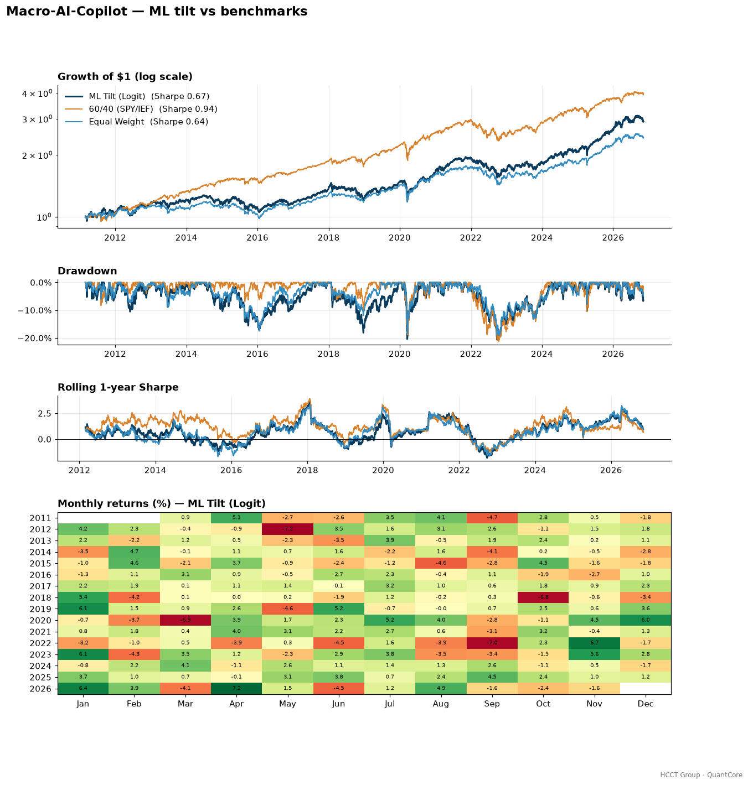
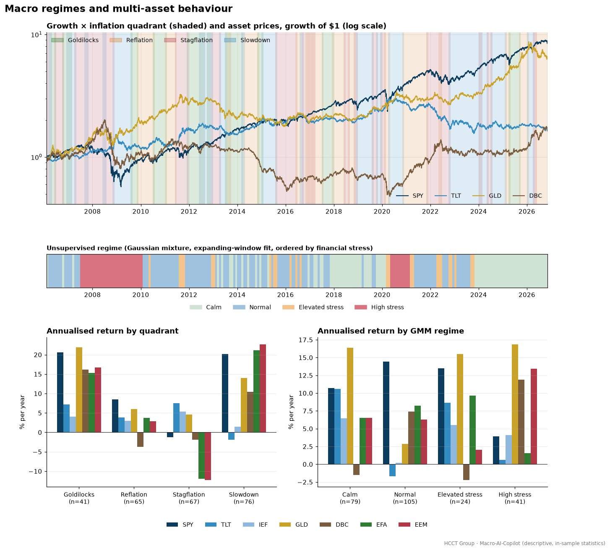

# Macro-AI-Copilot — results

Generated by `python run_macro_ai_copilot.py`. Out-of-sample backtest period
**2011-03-01 → 2026-11-06** (daily returns, monthly rebalancing, trades executed the
day after the month-end signal, 1 bp commission + 2 bp slippage on turnover).
Universe: SPY, TLT, IEF, GLD, DBC, EFA, EEM. Long-only, max 35% per asset for the ML tilt.

## Strategy performance

| Metric | ML Tilt (Logit) | ML Tilt (GBM) | Regime Playbook | 60/40 (SPY/IEF) | Equal Weight |
|---|---:|---:|---:|---:|---:|
| CAGR | 7.04% | 8.03% | 4.66% | 9.12% | 5.80% |
| Ann. Vol | 11.14% | 11.84% | 9.60% | 9.84% | 9.44% |
| Sharpe | 0.67 | 0.71 | 0.52 | 0.94 | 0.64 |
| Sortino | 0.92 | 1.00 | 0.72 | 1.33 | 0.90 |
| Max Drawdown | -20.63% | -19.47% | -19.57% | -21.29% | -19.16% |
| Calmar | 0.34 | 0.41 | 0.24 | 0.43 | 0.30 |
| Beta vs EW | 1.07 | 1.12 | 0.91 | 0.85 | 1.00 |
| Avg Daily Turnover | 0.95% | 2.86% | 0.98% | 0.10% | 0.15% |
| Annual Cost Drag | 0.07% | 0.22% | 0.07% | 0.01% | 0.01% |

## Out-of-sample prediction quality

Each month the models predict, for every ETF, the probability that it beats the equal-weight
basket over the next month. Models are retrained on an expanding window using only labels already
realised (logistic monthly, GBM every 3 months).

| Metric | Logistic | Gradient boosting |
|---|---:|---:|
| OOS months | 189 | 189 |
| Hit rate (beats basket?) | 52.5% | 54.1% |
| Mean rank IC | 0.089 | 0.108 |
| IC t-stat | 2.60 | 3.38 |
| Top-minus-bottom asset, avg monthly | 0.83% | 0.52% |

### Robustness: publication lag

Re-running the logistic model with every monthly macro series lagged **2 months** instead of 1
(a stricter point-in-time assumption) gives:

| Metric | ML Tilt (Logit) | ML Tilt (Logit, 2m lag) |
|---|---:|---:|
| CAGR | 7.04% | 7.15% |
| Ann. Vol | 11.14% | 11.02% |
| Sharpe | 0.67 | 0.68 |
| Max Drawdown | -20.63% | -20.56% |

Mean rank IC with a 2-month lag: 0.077 (t = 2.17).

## Regimes

Share of out-of-sample months by quadrant: Slowdown 32%, Reflation 29%, Stagflation 24%, Goldilocks 15%.
Share by GMM regime: Normal 42%, Calm 41%, Elevated stress 12%, High stress 5%.

Annualised average next-month return per asset, grouped by the regime known at the decision date
(descriptive, full available history since 2006 — not a trading result):

**Quadrant**

| | SPY | TLT | IEF | GLD | DBC | EFA | EEM |
|---|---:|---:|---:|---:|---:|---:|---:|
| Goldilocks (n=41) | +20.6% | +7.2% | +4.0% | +21.9% | +16.1% | +15.3% | +16.7% |
| Reflation (n=65) | +8.5% | +3.8% | +3.0% | +6.0% | -3.7% | +3.7% | +2.9% |
| Stagflation (n=67) | -1.2% | +7.5% | +5.4% | +4.6% | -1.8% | -12.0% | -12.3% |
| Slowdown (n=76) | +20.2% | -1.9% | +1.4% | +14.0% | +10.5% | +21.2% | +22.7% |

**GMM regime**

| | SPY | TLT | IEF | GLD | DBC | EFA | EEM |
|---|---:|---:|---:|---:|---:|---:|---:|
| Calm (n=79) | +10.7% | +10.6% | +6.5% | +16.4% | -1.5% | +6.5% | +6.5% |
| Normal (n=105) | +14.4% | -1.7% | +0.2% | +2.9% | +7.4% | +8.2% | +6.3% |
| Elevated stress (n=24) | +13.5% | +8.6% | +5.5% | +15.5% | -2.2% | +9.6% | +2.0% |
| High stress (n=41) | +3.9% | +0.6% | +4.1% | +16.9% | +11.9% | +1.6% | +13.4% |

## Latest reading (data through 2026-11-06)

- Quadrant: **Goldilocks**; GMM regime: **Calm**.
- ML tilt target weights:

| SPY | TLT | IEF | GLD | DBC | EFA | EEM |
|---:|---:|---:|---:|---:|---:|---:|
| 21% | 0% | 2% | 19% | 21% | 19% | 18% |

## News sentiment demo (toy data, not in the backtest)

Lexicon scorer on `data/raw/news_headlines.csv` (40 hand-written demo headlines).
Accuracy vs hand labels: **90%**. The lexicon and the sample were written together, so this is
an in-sample sanity check, not an out-of-sample accuracy estimate.

| label \ predicted | negative | neutral | positive |
|---|---:|---:|---:|
| negative | 14 | 1 | 0 |
| neutral | 0 | 9 | 0 |
| positive | 0 | 3 | 13 |
